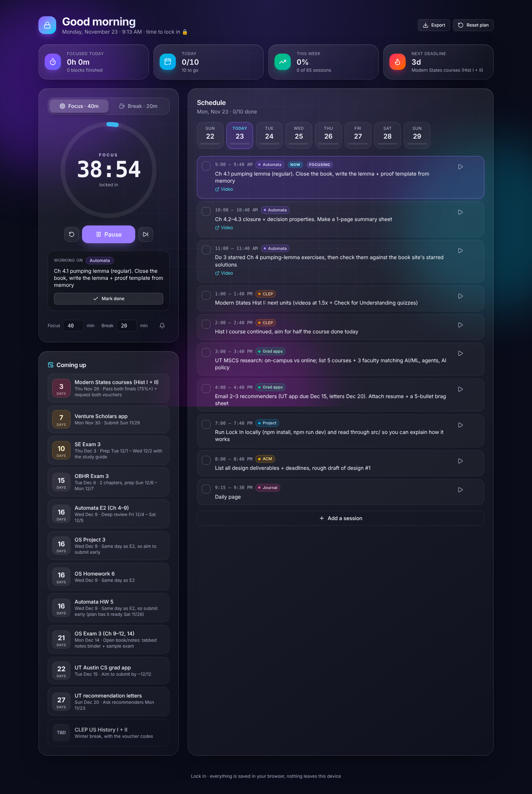
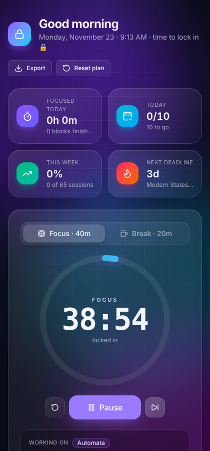

# Lock In 🔒

A glassmorphism focus timer and schedule tracker for staying on top of a packed week.



## What it does

- **Focus timer:** a 40-minute focus / 20-minute break cycle by default, adjustable. Start a block from any task with ▶. The timer flips to break on its own, plays a chime, sends a browser notification, and shows the countdown in the tab title.
- **Schedule:** a day-by-day view of every session with check-offs, category colors and video links. The session happening right now is tagged **Now**, and anything past due shows its time in amber. Add or delete sessions on any day.
- **Progress:** focus time and finished blocks today, today's check-offs, week completion %, and per-day progress bars.
- **Deadlines:** countdown chips that go amber at 10 days and red at 3.
- **Saved locally:** everything lives in `localStorage`, with no account or backend. **Export** downloads a JSON backup, and **Reset plan** restores the original schedule.



## Stack

React 19 · TypeScript · Vite · Tailwind CSS v4 · shadcn/ui-style components (Radix + CVA) · lucide icons · Vitest

## Run it

```bash
npm install
npm run dev     # http://localhost:5173
npm test
npm run build
```

## Make it yours

- **Your name:** click the greeting to set it. It's saved only in your browser, never in the code.
- **Your plan:** edit `src/data/seed.ts` (sessions + deadlines), or add sessions in the app.
- **Categories and colors:** edit `src/lib/categories.ts`.
- **Default timer lengths:** set them in `App.tsx` (`focusMin` / `breakMin`), or change them right in the timer card.

## Project layout

```
src/
  App.tsx                  layout, stats, wiring
  components/
    FocusTimer.tsx         progress ring, controls, attached task
    Schedule.tsx           day picker, session list, add form
    Deadlines.tsx          countdowns
    ui/                    shadcn-style primitives (button, card, badge, input, tabs)
  hooks/
    useTimer.ts            timestamp-based countdown (survives refreshes + background tabs)
    usePersistentState.ts  useState backed by localStorage
  lib/                     time helpers, types, categories (+ tests)
  data/seed.ts             the week's plan
```

## Deploy

Every push to `main` runs the tests, builds the site, and publishes it to GitHub Pages (`.github/workflows/deploy.yml`). Turn it on once under **Settings → Pages → Source: GitHub Actions**.

## License

MIT
